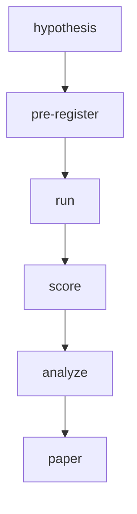

<p align="center">
  <a href="https://conventionalcommits.org"></a>
  <a href="https://docs.github.com/en/repositories/creating-and-managing-repositories/creating-a-repository-from-a-template"></a>
</p>

<h1 align="center">grounding-source-exhibit</h1>

grounding-source-exhibit is a template repository for pre-registered LLM experiments. Each experiment is committed before it runs: a protocol, runner prompt, and scorer prompt are fixed in git, results are collected as raw sessions, scoring is performed blind against a rubric, and the analyzed record validates against the schema in [DATA_DICTIONARY.md](DATA_DICTIONARY.md) in CI. This structure makes every reported number traceable to a pre-registered design and reproducible by anyone with repository access.

## Lifecycle



The rendered diagram is optional; the Mermaid source above is the canonical artifact and is committed inline in this README.

## Experiment Index

| Slug | Question | Status | Key Result |
|------|----------|--------|------------|
| `grounding-source-exhibit` | Does grounding-source payload (llms.txt vs knowledge-graph.json + cluster slice vs OKF v0.3) affect agent retrieval on reading-chain questions? | pre-registered | pending (sealed in [seal.json](seal.json)) |

## Repository Layout

- `experiments/` - one directory per pre-registered experiment (see [experiments/README.md](experiments/README.md))
- `recipe/` - analysis notebooks and scripts that regenerate figures
- `figures/` - generated figures
- [METHODOLOGY.md](METHODOLOGY.md) - shared experimental design contract
- [DATA_DICTIONARY.md](DATA_DICTIONARY.md) - schema for `analysis.json` and `scores.json`
- [CITATION.cff](CITATION.cff) and `.zenodo.json` - citation metadata
- [seal.json](seal.json) - frozen pre-registration (arms, metrics, pilot gate, statistics)

## Reproduction

1. Clone the repository and check out the tag matching the release.
2. Install [uv](https://docs.astral.sh/uv/).
3. Validate the dataset schema:

   ```bash
   uv run python validate_schema.py
   ```

4. Regenerate figures from the recipes in `recipe/`.

Each experiment directory under `experiments/` contains its protocol, runner and scorer prompts, raw sessions, and analysis records, so any result can be traced back to its pre-registered design.

## Figures

Figure scripts live in `figures/` and render from committed `results/raw/` records only; each exits with a message until the run produces data.

- `figures/fig1-arm-comparison.py` - exact-match proportion per arm with 95% Wilson score intervals
- `figures/fig2-partial-credit.py` - per-arm partial-credit distributions (jittered strip over box plot) with Welch t annotation
- `figures/fig3-per-question-deltas.py` - paired per-question exact-match deltas (improved/tied/worsened) for the two pairwise arm comparisons

Regenerate with:

```bash
uv run --with matplotlib python figures/fig1-arm-comparison.py
uv run --with matplotlib python figures/fig2-partial-credit.py
uv run --with matplotlib python figures/fig3-per-question-deltas.py
```

## Raw-Response Logging

The upstream bench (clouatre-labs/clouatre.ca experiments/) persists captured bodies truncated to 512 bytes (`body_512b` in its D1 samples table). The pre-registered secondary metric (per-step prefix credit) is computed post-hoc from raw logs and requires untruncated responses, so this repository commits its own runner, `recipe/run-bench.sh`, which drives the bench per arm and stores the FULL raw response for every run under `results/raw/<arm>/run-<id>.json` before any scoring. This satisfies the pre-run verification requirement that raw responses are captured without truncation for all three arms (`llms-txt`, `kg-json`, `okf-bundle`), and `analysis.py` re-derives every reported number, including partial credit, from these artifacts.

## Pre-Registration

[seal.json](seal.json) was committed before the first run. It fixes the three arms and their exact payloads, n=103 per arm, the primary exact-sequence-match metric (scorer `resolveChainSequence`, pinned to clouatre-labs/clouatre.ca experiments/src/bench-do.ts at commit 74105922c993a06d06a2291d5b73c48dc445aa1a), the secondary partial-credit metric, a blocking pilot gate (best arm must reach at least 3/20 exact matches, otherwise STOP and re-register), and the statistical tests (two-proportion score test on exact-match deltas, Welch t on partial credit, raw p-values only).

## Citing This Work

See [CITATION.cff](CITATION.cff). Authors, version, and release date are filled; DOI identifiers will be added after Zenodo deposit.

## Repository Setup

This repository was created from clouatre-labs/template-exp-repo. Standard labels come from `bash scripts/bootstrap.sh`; the main-branch ruleset mirrors the house pattern (squash-only, deletion and non-fast-forward protection, DCO sign-off, required CI Result / Security Result / Lint markdown checks).
