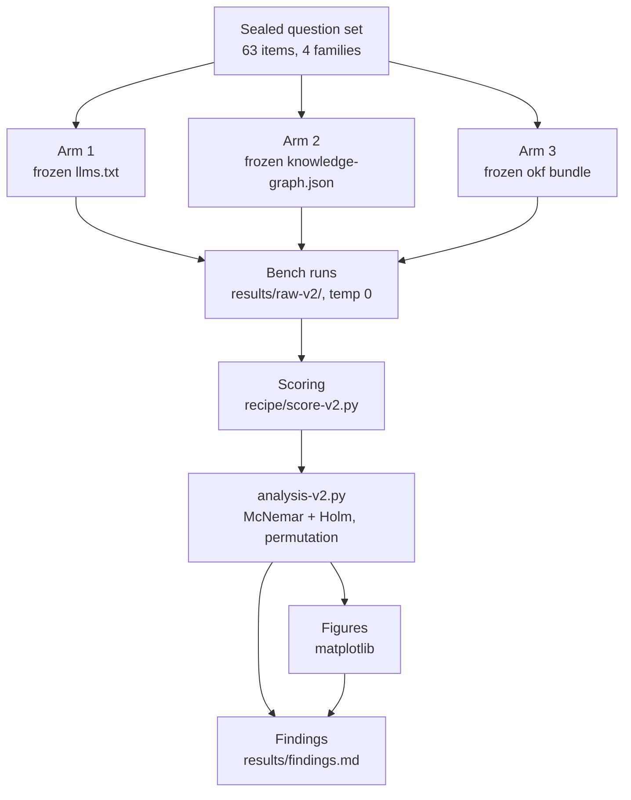
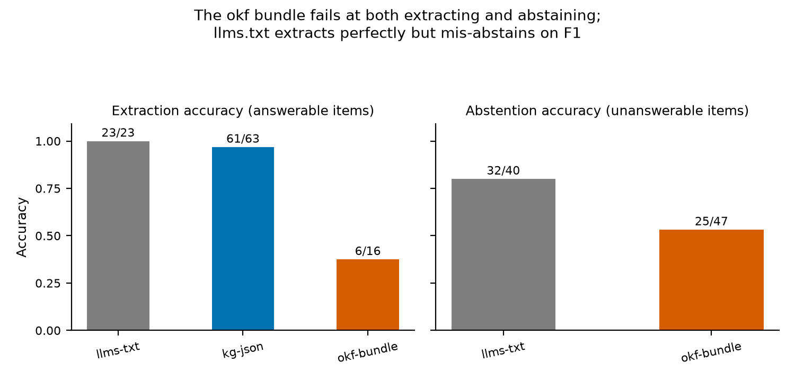
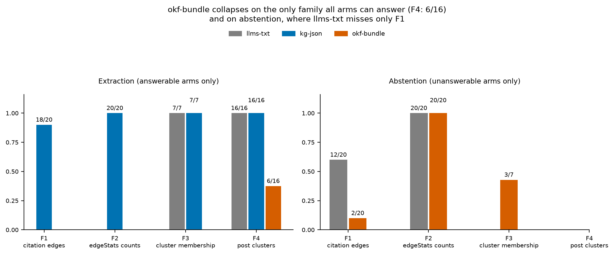

<p align="center">
  <a href="LICENSE"></a>
  <a href="https://conventionalcommits.org"></a>
  <a href="results/analysis-v2.json"></a>
  <a href="seal-v2.json"></a>
  <a href="results/raw-v2/"></a>
<a href="https://doi.org/10.5281/zenodo.24424679"></a>
</p>

<h1 align="center">grounding-source-exhibit</h1>

grounding-source-exhibit is a pre-registered comparison of three grounding-source payloads for AI agents on clouatre.ca content: the frozen `llms.txt`, the full frozen `knowledge-graph.json`, and the frozen OKF v0.3 bundle. [seal-v2.json](seal-v2.json) was sealed before any v2 run: 63 questions across four preregistered families (citation edges, edgeStats link counts, forward cluster membership, cluster membership) with a per-family answerability map — a run that correctly abstains on an unanswerable item scores 1 — a primary item-score endpoint scored by pairwise McNemar exact test with Holm-Bonferroni, a secondary paired permutation test on partial credit (10000 permutations, seed 20261123), and a blocking pilot gate. Every reported number re-derives from [results/raw-v2/](results/raw-v2/) by the committed [analysis-v2.py](analysis-v2.py). **Outcome: kg-json scored 61/63 and llms.txt 55/63 (Holm p = 0.070, not separable); the okf bundle scored 31/63 and lost to both arms (Holm p < 1e-5) with 23/63 context truncations and confident wrong answers on most unanswerable items.**

## Status

**Status: complete. Outcome: kg-json scored 61/63 and llms.txt 55/63 (Holm p = 0.070, not separable); the okf bundle scored 31/63 and lost to both arms (Holm p < 1e-5) with 23/63 context truncations and confident wrong answers on most unanswerable items.** Full statistics in [results/analysis-v2.json](results/analysis-v2.json); findings in [results/findings.md](results/findings.md).

The run history matters and is reported as such: the v1 run aborted before scoring (coverage ceiling; archived in [results/raw-v1-aborted/](results/raw-v1-aborted/)); the v2.0 pilot gate STOPPED the full run on a mis-preregistered F3 family and both non-kg arms answered confidently wrong (archived in [results/raw-v2-pilot-aborted/](results/raw-v2-pilot-aborted/)); v2.1 re-registered F3 as forward cluster membership before any v2.1 item ran, its pilot passed all four blocking gates ([results/raw-v2-pilot-pass/](results/raw-v2-pilot-pass/)), and only then did the full run execute. The v1 seal is archived at Zenodo DOI 10.5281/zenodo.24410381; the v2.1 run is deposited at DOI 10.5281/zenodo.24424679 under the same concept record.

## Experiment Index

| Slug | Question | Status | Key Result |
|------|----------|--------|------------|
| `grounding-source-v2.1` | Which grounding surface can an agent actually use: llms.txt, knowledge-graph.json, or the OKF v0.3 bundle? | complete | kg-json and llms.txt not separated; okf-bundle loses to both — see [results/findings.md](results/findings.md) |

## Pipeline



*Diagram: The experiment pipeline. The sealed v2.1 question set feeds all three arms, each grounded by a distinct frozen payload verified by sha256 at run start; the bench stores full raw responses per arm, score-v2.py applies the sealed per-family metric definitions with the answerability map, analysis-v2.py derives the preregistered statistics, and the figures and findings render from the same raw records.*

## Endpoints

*Table 1: Primary endpoint per arm over the same 63 sealed questions (`results/raw-v2/`; re-derive with `uv run python analysis-v2.py --questions ground-truth/full-v2.1.json`).*

| Arm | n | Item score | Rate | Wilson 95% | Extraction acc. | Abstention acc. | Truncations |
| --- | --- | --- | --- | --- | --- | --- | --- |
| kg-json | 63 | 61 | 0.968 | [0.891, 0.991] | 0.968 (n=63) | n/a | 2 |
| llms-txt | 63 | 55 | 0.873 | [0.769, 0.934] | 1.000 (n=23) | 0.800 (n=40) | 2 |
| okf-bundle | 63 | 31 | 0.492 | [0.373, 0.612] | 0.375 (n=16) | 0.532 (n=47) | 23 |

Pairwise McNemar exact tests with Holm-Bonferroni, and the secondary paired permutation test on partial credit, are in [results/findings.md](results/findings.md) (Primary and Secondary Endpoint sections) and re-derive from [results/analysis-v2.json](results/analysis-v2.json): llms.txt vs kg-json is not separated (Holm p = 0.070); okf-bundle loses to both (Holm p = 1.6e-6 and 4.6e-8).

## Repository Layout

- `recipe/run-bench.sh` - bench runner; verifies every frozen payload sha256 against seal-v2.json at run start, then drives the model per arm at temperature 0 and stores the FULL raw response per run
- `recipe/score-v2.py` - sealed per-family scorer (set equality / dice for F1, F3, F4; integer match for F2; abstention scoring via the answerability map)
- `analysis-v2.py` - sealed statistics: McNemar exact + Holm, paired permutation on partial credit, conditional accuracies, truncation counts
- `results/` - raw records, findings, analysis output, and the archived v1 and v2.0 artifacts
- `ground-truth/` - blinded question files (committed pre-run) and plaintext question files (committed with raw outputs per the seal blinding note)
- `figures/` - one Python script plus one PNG per figure, deriving only from raw records
- [seal-v2.json](seal-v2.json) - frozen v2.1 pre-registration; [seal.json](seal.json) - archived v1 seal
- [METHODOLOGY.md](METHODOLOGY.md) - shared experimental design contract
- [DATA_DICTIONARY.md](DATA_DICTIONARY.md) - schema for `analysis.json` and `scores.json`
- [CITATION.cff](CITATION.cff) and `.zenodo.json` - citation metadata

## Reproduction

1. Clone the repository and check out the commit matching the release.
2. Install [uv](https://docs.astral.sh/uv/).
3. Re-derive every reported number:

   ```bash
   uv run python analysis-v2.py --questions ground-truth/full-v2.1.json
   ```

4. Regenerate figures from committed raw records:

   ```bash
   uv run --with matplotlib python figures/fig1-arm-comparison.py
   uv run --with matplotlib python figures/fig2-partial-credit.py
   uv run --with matplotlib python figures/fig3-conditional-accuracy.py
   uv run --with matplotlib python figures/fig4-family-breakdown.py
   ```

The plaintext questions committed in `ground-truth/full-v2.1.json` regenerate the blinded files' sha256 hashes recorded in seal-v2.json, so the question set is verifiable against the pre-run seal.

## Figures

Figure scripts live in `figures/` and render from committed `results/raw-v2/` records only.


*Figure 1: Preregistered item-score rate per arm (correct answer or correct abstention) over the same 63 sealed questions, with 95% Wilson intervals and Holm-adjusted McNemar exact brackets. kg-json and llms.txt are not separated (p = 0.070); the okf bundle loses to both (Holm p < 1e-5).*


*Figure 2: Secondary endpoint, and why it exists: the primary endpoint cannot separate llms.txt from kg-json, so this asks whether kg-json's answers are actually richer. Paired permutation on partial credit (jittered strip over box plot; dice overlap on set-valued families, integer fraction on F2): kg-json separates from both arms (p < 1e-4); llms.txt and okf-bundle do not (p = 0.44) despite a 38-point item-score gap. The distributions show the mechanism: llms.txt piles up at 0 (correct abstentions) and 1, okf-bundle smears across the middle on partial extraction, so the composite item score mixes the two and must be read with Figure 3's conditional accuracies.*



*Figure 3: Conditional accuracies, the two components of the composite item score. Extraction: llms.txt is perfect on its 23 answerable items, kg-json 61/63 overall, okf-bundle 6/16. Abstention: llms.txt 32/40, okf-bundle 25/47; the okf bundle fails at both components, llms.txt only mis-abstains on unanswerable F1.*



*Figure 4: Exploratory per-family breakdown (labeled exploratory in seal-v2.json), split so each bar means exactly one thing: the extraction panel shows only arms for which the family is answerable, the abstention panel only unanswerable ones. okf-bundle collapses on F4, the only family all arms can answer (6/16), and on abstention; llms-txt trails kg-json only on unanswerable F1.*

## Pre-Registration

[seal-v2.json](seal-v2.json) was sealed before the first v2 run and superseded the archived [seal.json](seal.json) v1 seal after the v1 abort. It fixes the three arms and their exact frozen payloads (sha256-pinned), 63 items per arm (F1: 20, F2: 20, F3: 7, F4: 16, seeds 20261124 pilot / 20261125 full), the per-family answerability map, the primary item-score metric with McNemar exact + Holm across the 3 pairs, the secondary paired permutation test on partial credit, per-family breakdowns labeled exploratory, the blocking pilot gate (floor, saturation, F3 competitiveness, llms-txt F4 extraction guard), and the model and sampling configuration (temperature 0, single attempt, retries on empty responses only). The v2.0 pilot-gate abort and the v2.1 re-registration of F3 are recorded in the seal header; nothing in the seal changed after the first v2.1 run.

## Citing This Work

See [CITATION.cff](CITATION.cff). Concept DOI: 10.5281/zenodo.24410380; current version: 10.5281/zenodo.24424679. The archived v1 seal is DOI 10.5281/zenodo.24410381; superseded v2.1.x snapshots are listed on the Zenodo record.

## Repository Setup

This repository was created from clouatre-labs/template-exp-repo. Standard labels come from `bash scripts/bootstrap.sh`; the main-branch ruleset mirrors the house pattern (squash-only, deletion and non-fast-forward protection, DCO sign-off, required CI Result / Security Result / Lint markdown checks).
